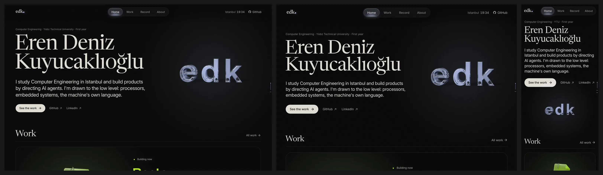
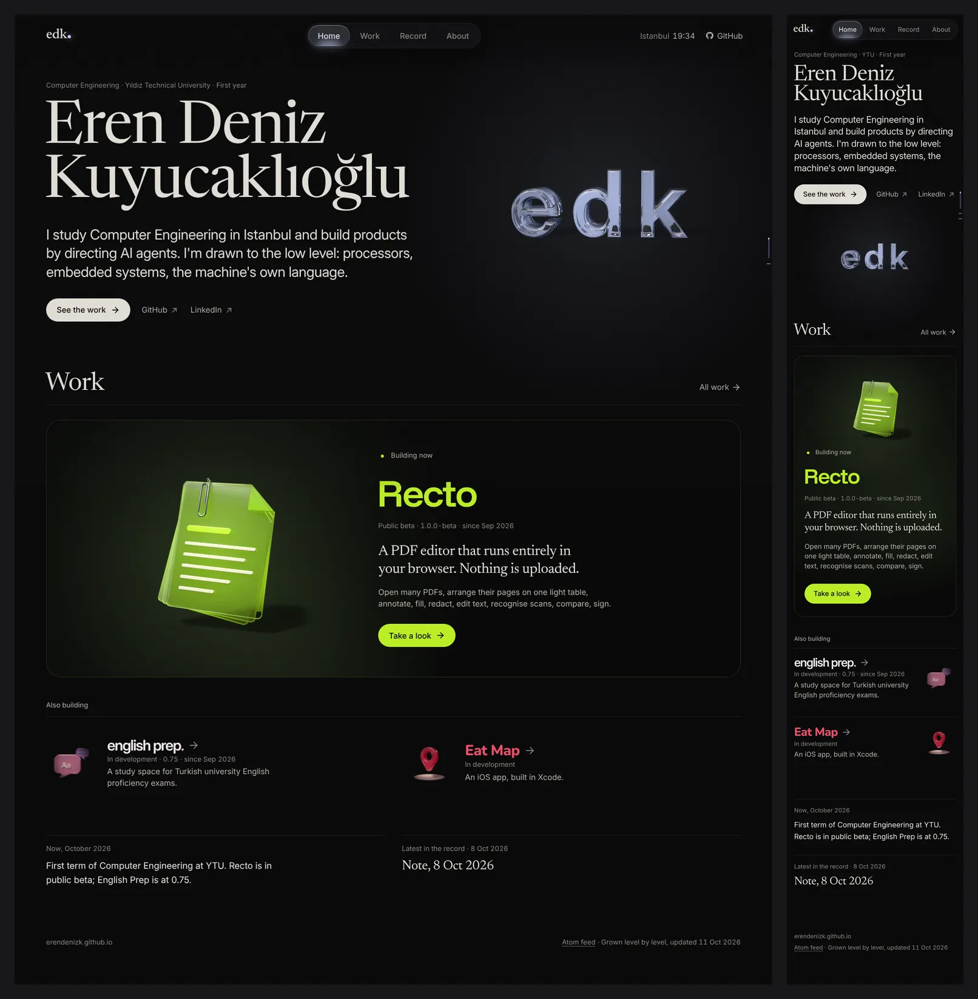
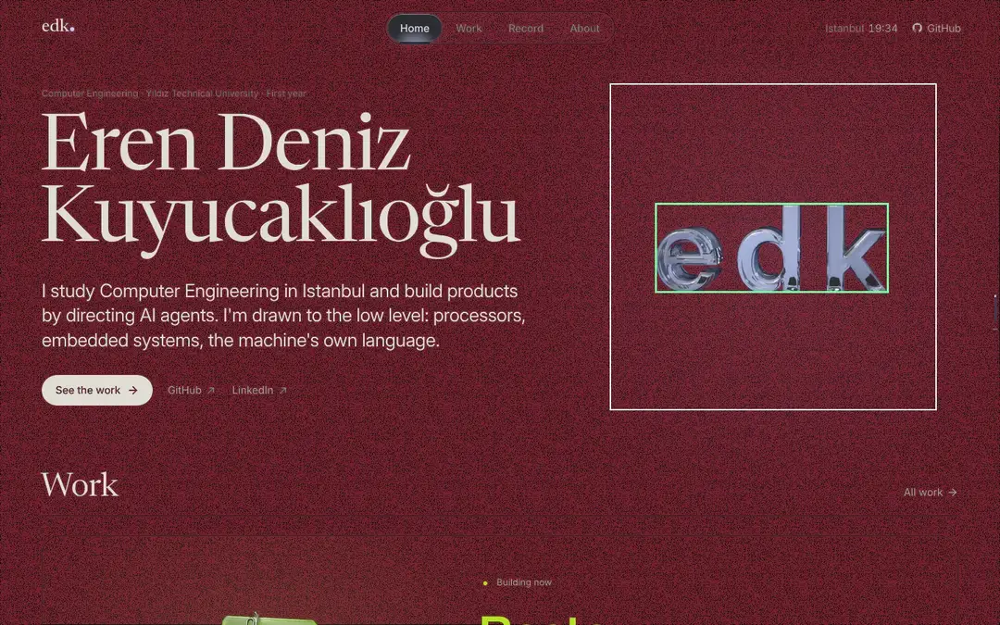
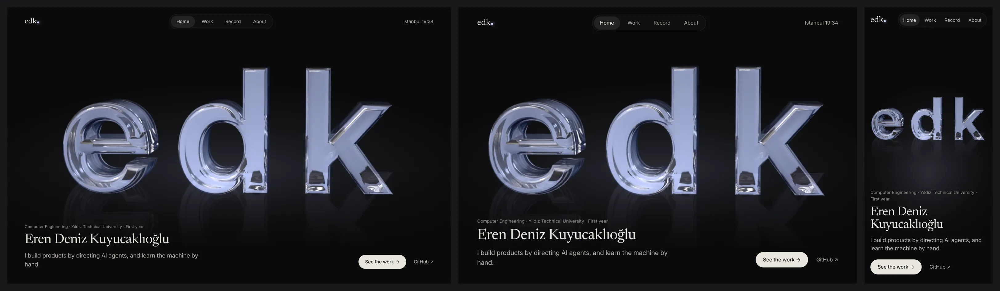
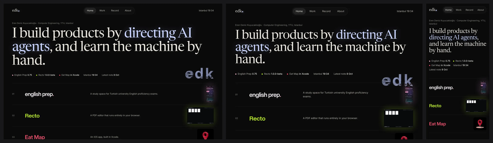
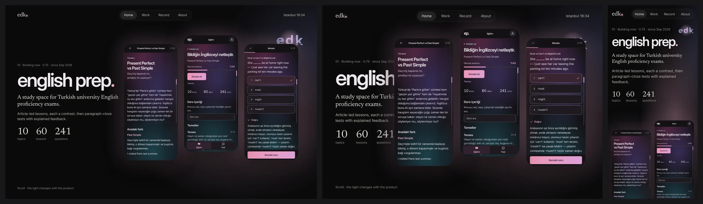

# Research: an award-level Home (2026-10-11)

**Status:** current, open. Nothing here is built. It feeds the two Home prototypes (`wip/home-a`, the
cinematic object stage, and `wip/home-b`, the living editorial index) and the owner's choice. The
three concept frames in §4 are static mocks made from the site's own assets, not designs to ship.

**Why:** brief log, 2026-10-11 evening: "Home feels very empty. It must be a stunning opening page
with a 'woaaww' effect, a design marvel ... It is the first page, so the most important one." Lines
that still hold: Home presents a product, an identity and a brand and conveys the vision; its layout
is good because it is simple, just not flashy enough (2026-10-10); Home is the showcase and Work the
catalogue, with no duplication (2026-10-09); the edk glass letters are now sharp and liked
(2026-10-11); a photo on Home is possible (2026-10-10); light as colour, dark, quiet, premium
(2026-10-08/09); objects stay pre-rendered (2026-10-11, option a); the owner checks mostly on an
iPhone.

**Evidence grades.** **M** measured here (Playwright on Chromium 1194 against a fresh build of `dev`
@ f299911, or files on disk). **S** a web-search extract (the page itself was not opened). **R**
recollection of a page as it was in 2024–26, not re-checked. **This session could not open any
outside site:** the fetch tool has no DNS for them and the egress proxy refuses CONNECT (403) to every
host except GitHub. So no reference page was timed or weighed live. The one reference measured is
Bruno Simon's 2025 portfolio, from its public repository. Treat the R rows in §2 as directions, and
open the pages before you quote a detail from them.

---

## 1. Measuring the current Home (M)

Method: `npm ci && npm run build`, then `node tests/serve.mjs dist 4471 /`, then Playwright at 1440×900 (fine
pointer, DPR 1), 1180×820 (touch, DPR 2) and 390×844 (touch, mobile, DPR 3). The scripts are in the
session scratchpad (`hm/measure.mjs`, `hm/timeline.mjs`) and are not kept.

### 1.1 Numbers

| | 1440×900 | 1180×820 touch | 390×844 phone |
|---|---|---|---|
| Page height | 1845 px (2.05 screens) | 1796 px (2.2) | 2142 px (2.5) |
| First screen holds | kicker, name (2 lines), 3-line lede, 3 links, edk object; the "Work" heading and the top edge of the Recto plate at y 771 | the same; plate edge at y 730 | kicker, name, 5-line lede, links, the edk object (210 px) at y 427–637 |
| Products visible on the first screen | none (the plate's top border only) | none | none |
| Real app screens anywhere on Home | **0** (Home shows the three category objects, never a capture) | 0 | 0 |
| Type sizes on screen | 112 / 48 / 27 / 26 / 15 / 13 px (Newsreader name, Inter lede) | 92 / 40 / 22 / 15 / 13 | 48 / 36 / 20 / 15 / 13 |
| Share of the first screen that is empty ground ¹ | **79 %** | 93 % ² | 89 % |
| edk object box | 470 × 470 px | 437 × 437 | 210 × 210 |
| **Area the glass letters actually cover** ³ | 336 × 130 px = **3.4 % of the screen** | 3.9 % | **2.6 %** |
| FCP / LCP (local, no throttle) | 192 ms / 236 ms (edk poster), then a re-entry at 1060 ms when the glint layer paints | 480 / 512 ms (poster) | 1364 ms / 1364 ms (the lede) |
| LCP, phone at 9 Mbit/s, 85 ms RTT, 4× CPU | | | **472 ms** (the lede); the object is fully painted at ~0.8 s |
| CLS | 0.000 | 0.000 | 0.000 |
| Requests / bytes on load | **419 / 3.86 MB**: 396 of the requests are lean-grid frames for edk *and* Recto, fetched at idle before any pointer comes near | 222 / 2.71 MB (Recto's lean grid, 202 frames) | **20 / 646 KB** |
| Motion on arrival (first visit) | none composed. The poster is simply there. Then a ±8° WAAPI float (6.98 s loop) on both objects; a glint sweep; the lean answers a pointer within reach | the float plus edk's spin loop (1040², 4 s, 230 KB H.264) | the float plus the spin loop |
| First interaction | hover near the letters: a 33×3 lean grid; press: a 1 s hop clip | tap: none on the hero | tap: none on the hero |

¹ Pixels darker than luma 38 with no local edge, sampled every 2 px. Grain makes this approximate.
² At 1180, DPR 2 the 437 px object and the type sit in a wider, darker field.
³ The poster is a 1200² frame in which the letters fill 858 × 331 px (72 % × 28 %). The rest of the
box is black ground.

### 1.2 A designer's diagnosis: why it feels empty

1. **The hero object is a postage stamp.** The site's best asset, the glass letters the owner loves,
   covers 3.4 % of a desktop screen and 2.6 % of a phone screen. It sits in a 470 px box that is 92 %
   black. Every award-level hero in §2 gives its one hero thing between 40 % and 100 % of the
   viewport. Here the name, at 112 px, outweighs the object, so the page reads as a CV header with a
   logo beside it.
2. **Nothing happens in the first three seconds.** Everything is painted by 0.24 s and then it is
   over: no entrance, no light change, nothing that tells you the page is alive except a sway you
   notice only if you watch. (`data-arrive` holds the poster for 1.6 s only when you come from
   another tab, never on a first visit from LinkedIn.)
3. **The light is a rumour.** The brand is "light as colour", but the first screen is monochrome:
   an ≤ 8 % cool pool you cannot see on a phone, and the family's colours (lime, sakura, rose, blue,
   gold) appear nowhere above the fold except in the bar's dot.
4. **The words are a bio, not a thesis.** "I study … I'm drawn to …" is About's material. Nothing
   on the first screen is a claim worth remembering. (Copy is the owner's, or the lead's draft
   until then: brief, 2026-10-10.)
5. **The real products are absent.** Home shows a green document icon, a pink speech bubble and a
   red pin: symbols, never the apps. The sharp captures that make Work strong do not appear on Home.
6. **There is nothing to scroll for.** Two screens, then the footer. No chapter changes the picture,
   the light or the pace, so the visitor's first scroll is not rewarded.
7. **Phones get the weakest version.** The object drops below the links with a ~200 px dead band
   around it; the products start on screen two; the lede is five lines of 20 px.
8. **The desktop pays for motion nobody sees.** 3.1 MB of lean frames (396 AVIFs, both tiers, edk and Recto) load at idle,
   for a hover most visitors never make. That budget could pay for a hero that every visitor sees.

What is right and must survive: the name in Newsreader, the bar and its lit tabs, the restraint, the
sharp glass, the zero CLS, the fast LCP, the phone's 646 KB.

---

## 2. Award analysis

Twenty pages and studios that set the bar for "wow" in 2023–26. *First 3 s* is what creates the
effect, *sustains* is what keeps it, *cost* is what it takes. Fit is judged against this site.

| # | Page | Grade | First 3 s | Sustains | Cost | Fit |
|---|---|---|---|---|---|---|
| 1 | **Bruno Simon, folio 2025** (Awwwards case study, Mar 2026: a rebuild "for the WebGPU era" in TSL) | S, M (repo) | you are dropped into a driveable toy world | exploration, physics, sound, secrets | **M:** `static/` holds 197 MB in the repo: 64 GLB models (6.2 MB), 88 KTX textures (3.3 MB), 88 sounds (~20 MB); three.js 0.183; a game loop with physics | no: a game hides the person and the products; the lesson is *one world, one idea, total commitment* |
| 2 | **Lusion v3** (in Awwwards' SOTY 2023 WebGL list; Cannes Lions 2024 entry: a "living portfolio") | S, R | a real-time 3D scene that reacts to the cursor at once | scroll-driven scene changes, reactive cursor | heavy WebGL, a loader | partly: the reaction to the *first* pointer move is the lesson |
| 3 | **Igloo Inc** (Awwwards SOTY 2024) | S | ice blocks rendered in the browser; one material carries the brand | an endless scroll loop: igloo, ice, portal, particles, igloo | a custom VDB volume exporter; a reviewer could not tell the blocks were clickable | **high in spirit:** one glass/ice material as the whole brand is exactly what edk's glass can be; the navigation critique is a warning |
| 4 | **Lando Norris, by OFF+BRAND** (2025; Awwwards listing shows a SOTY 2025 badge nearby, not verified) | S | a big photo of the person with cursor-reactive fluid overlays that echo his helmet's graphics; lime `#CBF902` | On Track / Off Track chapters | photo-led, mid weight | **high:** a personal brand = the person's face + one signature interactive layer + one accent colour |
| 5 | **Messenger, by Abeto** (SOTD 2025, 7.92) | S | a tiny planet multiplayer game | play | a game | no |
| 6 | **Active Theory v5/v6** | S, R | an environment with a big screen playing the reel; particle effects with the mouse | environments you switch between | WebGL, loader | no: agency scale |
| 7 | **Dennis Snellenberg** (personal site; Osmo SOTD Dec 2025; with Ilja van Eck "28 SOTDs") | S, R | his photo, large and centred, with his name as a giant slow marquee behind it; magnetic buttons | curved page wipes, smooth scroll, a spinning "located in" globe | light (images + JS), about 1–2 MB (R) | **high:** photo + kinetic name is cheap and personal; smooth-scroll hijack is not allowed here |
| 8 | **Rauno Freiberg** | S | a desktop-OS metaphor: dock, interface sounds | horizontal galleries of work, experiments, photos | moderate | partly: craft in micro-interaction; the OS metaphor is his, not ours |
| 9 | **Paco Coursey** | R | almost nothing: tiny type, taste | detail | tiny | low: proves restraint impresses designers, not a first-time visitor from LinkedIn |
| 10 | **Emil Kowalski** | S | precise motion in small components | his rules: entrances from scale 0.95, never 0; popovers grow from their trigger | tiny | high for *how* things move, not *what* moves |
| 11 | **Linear** (2025 redesign pulled back to black and white) | S, R | a huge, tightly tracked headline over the product UI, lit from above, in perspective | feature sections with sticky media | moderate | **high:** real UI as the hero picture; one accent |
| 12 | **Vercel Ship** event pages | R | a giant rendered glass prism with light and grid lines | big type, countdowns, live data | moderate | high: glass + light is our material too |
| 13 | **Apple product pages** (AirPods, MacBook) | S | a giant product that turns or opens as you scroll: a canvas scrubbing 60–180 pre-rendered frames | sticky media, one big claim per screen | tens of MB; iPhones crashed on one large sprite grid in a copy of the technique (S) | **highest technical fit:** this *is* pre-rendered media driven by scroll, the site's own method (ADR-0006) |
| 14 | **Teenage Engineering** | R | object photography of uncanny quality on a plain ground, tiny mono type | spec lines, oddness | light | high: the object as a product photograph; spec strips |
| 15 | **Locomotive** | R | big type, parallax image reveals | smooth scroll (their own library) | moderate | partly: reveals yes, scroll hijack no (ADR-0010) |
| 16 | **Obys Agency** | R | a counted preloader, then split-letter kinetic type | text reveals everywhere | loader on the critical path | low: requirements §2 forbids a loader on the critical path |
| 17 | **Studio Freight / darkroom** (authors of Lenis) | R | heavy type, 3D accents | smooth scroll | moderate | partly |
| 18 | **basement.studio** (Awwwards SOTD 2025, FWA SOTD 2025, per its own page) | S | real-time 3D and loud type | an arcade lab, mini-games | moderate to heavy | low: too loud for "quiet, premium" |
| 19 | **Resn** | R | playful, odd interactions | surprise | varies | low |
| 20 | **Lynn Fisher** (lynnandtonic.com) | R | a new concept every year; the art changes as the window narrows | resizing is the toy | light | **high for phones:** the phone layout as its own composition, not a squeezed desktop |

Recent winners in the portfolio category (S, not opened): Maria Vasilyeva (SOTD + Developer Award, 9 Oct
2026), Léo Parpeix "Portfolio 2026" (SOTD, 14 Sep 2026), Portfolio Honors NOTHIN', Podium, MERSI (Feb–Jul
2026). Open them before borrowing anything.

### 2.1 What the wow is made of

Across the twenty, the first three seconds come from five things, usually three at once:

1. **Scale.** One hero thing at 40–100 % of the viewport: an object (Apple, Igloo, Vercel), a face
   (Norris, Snellenberg) or a headline (Linear). Never a 3 % thing in a corner.
2. **A composed arrival, 1–2.5 s, over content that is already there.** Light comes on, the object
   settles, type follows. The best do it without a loader; the loader sites (Obys, Lusion, Active
   Theory) pay with a blank first screen.
3. **The page answers the first input.** The first pointer move, scroll tick or tap changes the
   hero: a lean, a turn, a ripple, a light that follows.
4. **Material and light you believe.** Glass, ice, metal, real photographs. This is where pre-rendered
   Cycles frames beat most real-time sites, and where this site already wins.
5. **The first scroll transforms the hero.** It turns, opens, shrinks into the next thing, or changes
   colour. Continuity is what makes scrolling feel like a story.

The wow is sustained by **chapters that each change the picture** (Apple's one claim per screen,
Igloo's sections), **real work shown big** (Linear's UI) and **details found later** (Rauno, Emil).
It is lost by loaders, scroll hijacking, games that hide the content, and by sameness: LogRocket's
note on Linear's style is that once a trend spreads, "all the products that follow it start to look
monotonous" (S).

**What it costs.** The WebGL sites weigh 5–200 MB and often show a loader on phones. The editorial
sites weigh 1–2 MB and rely on type alone. Apple's middle path, pre-rendered frames scrubbed by
scroll, gives WebGL-like presence for a few MB. That is the path this site's pipeline already
supports.

---

## 3. Patterns that fit this site, ranked

Constraints: static Astro; pre-rendered objects (ADR-0006, 2026-10-11 option a); native scrolling only
(ADR-0010 item 2); every effect has a still twin (reduced motion, no JS, Save-Data); phones first-class
and checked on an iPhone; no loader or intro on the critical path (requirements §2); content is data
(ADR-0002); unwritten sections hidden.

| Rank | Technique | What it does here | Effort | Risk |
|---|---|---|---|---|
| 1 | **Hero scale: the glass letters at 60–75 % of the width** (desktop letters ~950–1100 px wide; phone ~85–90 vw) on a reflective floor with a cool light pool | answers diagnosis 1 in one move; the mock in §4 shows what scale alone does | M: **needs a re-render.** Today's poster is 1200² with 858 px letters, so a 1072 px display at DPR 1 is already soft (visible in the mock), and a phone at DPR 3 wants ~1100 device px. Render a cropped wide frame (e.g. 2400 × 1000, letters ~2000 px) as AVIF/WebP tiers; expect 40–90 KB for the largest tier | low; owner sensitivity to softness is high, so ship only true-resolution tiers |
| 2 | **Light as the story: the stage light changes colour by chapter** (cool white-blue for edk, then sakura, lime, rose as each product arrives, then gold for the person) | the brand in one gesture; the glass is drawn plus-lighter, so a coloured glow *behind* it shows through as if refracted | S: a CSS custom property on the glow, driven by a scroll-driven animation (`animation-timeline: view()`, Chrome and Safari 26+, S) with an IntersectionObserver fallback | low; still twin: each chapter simply has its colour |
| 3 | **First-visit arrival, 1.6 s, over painted content**: the poster paints at once (LCP unchanged), then a pre-rendered "ignite" clip sweeps light through the letters and ends on the poster frame; the name and the line rise 12 px with an 80 ms stagger from 600 ms | answers diagnosis 2 without a loader | M: one 1.6 s render through the existing clip pipeline (droplet-in already works this way); once per session (`sessionStorage`) | medium: the clip must end pixel-exact on the poster, or it reads as a jump |
| 4 | **Real screens on Home, big, in each product's light**: one capture per product in a thin device frame (phone frames for English Prep, a browser frame for Recto), the Eat Map object until it has screens | answers diagnosis 5; one hero capture per product on Home, the full story on Work, so no duplication | S–M: the captures exist (`content/projects/*/captures`) | low |
| 5 | **The first scroll turns the letters** (Apple's scrubbed sequence): over the first ~120 vh the letters turn 30–40° and the light sweeps, then the hero hands over to the first chapter | answers diagnosis 6 and rewards the first scroll | M–L: 36–48 frames rendered on the same rig. Decoding is the danger: one 1040² RGBA frame is 4.3 MB in memory, so 48 frames are ~200 MB, too much for an iPhone. Decode a window around the current frame, as `lean.ts` already does; phones use half-size frames or the existing spin loop | medium on iOS; still twin: the poster |
| 6 | **A live line under the hero** (real data, built at build time): Istanbul time (exists), each product's version and status, days since each began, the latest record entry | the "public record" purpose, made visible; things that change tell the visitor the page is alive | S | low, as long as every value is real (no invented numbers) |
| 7 | **A thesis line as display type** (the lead's draft until the owner writes one, e.g. "I build products by directing AI agents, and learn the machine by hand.", assembled from `site.json`) with the name smaller above it | answers diagnosis 4 | S | taste: the owner decides the words; avoid the §18 tells (no "it's not X, it's Y", no triplet) |
| 8 | **The letters dock into the bar's `edk.`** as you leave the hero: they shrink and travel into the mark top left | turns the "logo shown twice" fault (site audit) into a deliberate story; the hero literally becomes the signature | M: a scroll-linked transform of the poster layer into the bar mark's box; the bar mark fades in as the letters arrive | medium: a geometric hand-off from a 3D render into 26 px type must look intended; prototype it before promising it |
| 9 | **Pointer light on desktop, tap-to-spin on phones**: a specular highlight that follows the pointer across the glass (the existing glint mask, positioned by the pointer); on phones a tap plays one turn of the spin | answers "the page answers the first input" (wow 3) on both platforms | S | low; tilt by device orientation needs an iOS permission prompt, so do not use it |
| 10 | **The person: one photo, handled** (the gate selfie as a print, or the ID card's front) in a gold-lit "who" chapter that links to About | Home gains a face without turning into About (brief: a photo on Home is possible) | S | taste: About keeps the card; Home shows a still print |
| 11 | **Chapter pinning without hijack**: each product chapter is `position: sticky` for one screen and the next slides over it | a scroll story with native scrolling; works on iOS | S | low; still twin: a plain stack |
| 12 | **A floor caustic under the letters**, rendered as a separate additive layer that brightens slightly on arrival | fills the empty ground with *light*, not with elements | S–M (one render pass) | low |
| 13 | **Cut the idle lean grids on Home**: load them on the first pointer approach, not at idle | 3.1 MB back for the hero (diagnosis 8) | S | none |
| 14 | **Text reveals, used once**: only the hero's two lines and each chapter's wordmark rise in; body text never animates | motion where it carries meaning | S | an "AI tell" of its own when every block fades up; keep it to the hero and wordmarks |
| 15 | Real-time WebGL on desktop | live refraction | L | the owner chose pre-rendered (2026-10-11); park it |

Rejected on purpose: loaders and intro screens (requirements §2), smooth-scroll hijack (ADR-0010),
sound, cursor replacement, games, a whole-site metaphor (rejected in round 1 as unity-breaking).

---

## 4. Three concepts

Each was mocked as a static frame from the site's real fonts, poster, captures and colours (session
scratchpad `hm/mock/`, not kept). The frames show composition only: no motion and no final copy. The
thesis line in them is the lead's draft, assembled from `site.json`.

### Concept 1: The glass stage

- **First screen.** Black. The edk glass letters span ~75 % of the width at mid-height, standing on a
  dark reflective floor (their reflection at 18 %), in a pool of cool white-blue light. Bottom left:
  the kicker, the name at 44 px, the thesis line. Bottom right: See the work, GitHub. The bar as now.
- **Arrival (first visit only).** 0 ms: poster and text painted, letters at 40 % brightness. 200–1400 ms:
  the ignite clip, a light band crossing the letters left to right while the floor pool brightens.
  600 / 680 / 760 ms: kicker, name and line rise 12 px and fade in, 500 ms each on the house spring.
  Done at 1.6 s. Repeat visits and reduced motion: the final state at once.
- **Scroll.** 0–120 vh: the letters turn ~35° (scrubbed frames) as the light shifts toward the first
  product's colour. 120–160 vh: the letters shrink and dock into the bar's `edk.`. Then the
  showcase as now, then the now/record line, links and the footer.
- **Interaction.** Desktop: the lean (loaded on approach) plus a pointer highlight. Phone: tap for one
  turn.
- **Phone.** Letters at ~88 vw in the upper half, text in the lower half; the turn uses half-size
  frames; no docking (the bar mark is too small to read the hand-off).
- **For:** the biggest wow per byte, built on the asset the owner loves, close to Apple and Igloo.
  **Against:** after the hero the page is the same as today. The wow lasts one screen and the
  products are still symbols.

### Concept 2: The living index

- **First screen.** A thesis headline at 96 px Newsreader across the width, with "directing AI
  agents" lit in edk's light. A live line under it: a coloured dot for each product with its version
  or status, Istanbul time, the latest note. Then an index: three ruled rows, each a number, the
  wordmark in its own face, one line, and a real screen thumbnail lit in the product's colour. The
  glass letters are small, at the side.
- **Motion.** The headline's words rise in, staggered (900 ms total). Desktop hover on a row: the
  thumbnail grows into a large floating preview that follows the pointer. The live values tick.
- **Scroll.** Below the index: the record (latest entries), the person (one photo), links.
- **Phone.** Headline at 40 px over four lines, live line wrapped, rows with the thumbnail on the right.
- **For:** cheap (under 1 MB), honest, shows the real products and the continuous record on the first
  screen. **Against:** the wow is typographic, so it is weaker in the first three seconds and weakest
  on a phone. It is the most copied portfolio pattern of 2024–26 (Linear, Paco, Rauno descendants).
  It demotes the letters the owner loves. A full product index duplicates Work.

### Concept 3: Light chapters *(recommended)*

Concept 1's first screen, and a scroll story in which **the light is the narrative**:

1. **edk, cool white-blue: who.** The glass stage and its arrival exactly as in concept 1, plus the
   live line (pattern 6) as one quiet row under the thesis.
2. **The first scroll.** The letters turn (scrubbed, ≤ 40 frames) and *shrink to a small glass object
   that stays with the visitor* in the top right of each chapter, picking up each chapter's colour
   through its plus-lighter glow (the mock shows it in sakura). This replaces docking into the bar:
   it is cheaper, works on phones, and carries continuity.
3. **One chapter per product, one screen each, sticky** (pattern 11), each lit in its own colour:
   English Prep in sakura (wordmark at 88 px, pitch, the real numbers 10 / 60 / 241, three real phone
   screens), then Recto in lime (a browser frame on the light table, the public-beta line), then Eat
   Map in rose (its object and status until it has screens). Order and the lead product follow
   `featured` (an owner question, below).
4. **The person, gold.** One print (the gate selfie), one line, "The long version" to About. The
   light turns warm.
5. **The record, blue.** The latest entries when there are real ones (hidden until written), the
   links, the footer.

- **Motion timing.** Arrival as concept 1 (1.6 s). Chapter light crossfades over the 40 vh before
  each chapter (scroll-linked, no timers). A chapter's wordmark rises in once; captures do not
  move; at most one signature clip plays at a time (ADR-0006), only when its chapter is pinned.
- **Phone.** Each chapter is one screen: the wordmark and the pitch on top, two phone screens rising
  from the bottom edge, the small glass object top right. The turn uses half-size frames, or the
  existing spin loop on Low Power Mode or Save-Data. Light chapters work identically.
- **Still twin.** No JS or reduced motion: the poster hero, then the chapters as plain sections,
  each with its colour. No WebGL anywhere.
- **Budget (estimate).** Phone first screen ≤ 700 KB (hero tier, fonts, one capture). The whole page
  ≤ 3 MB on desktop, once the idle lean grids stop loading (pattern 13).
- **Why this one.** It keeps the asset the owner loves and makes it the hero at real scale (wow
  1, 2, 4). It answers the first scroll with a transformation (wow 5) and gives every later screen
  a new picture, in the brand's own terms: light as colour. It puts the real products on Home without
  duplicating Work (one capture set per product here, the case study there). It works on the iPhone
  the owner checks with, and its still twin is a complete page. It is "a better introduction" with
  "the simple layout": hero, work, person, record, in that order, only now each part has a light and
  a picture.
- **Against.** It is the largest of the three: a re-render, a scrub sequence and three chapter
  layouts. The arrival clip must end exactly on the poster frame. Build it in steps (§5).

### 4.1 Where this research supports or contradicts the two prototypes

**Direction A, the cinematic object stage (`wip/home-a`).**
- *Supported:* the edk object as the hero at scale with scroll choreography is the strongest finding
  of §2 (Apple, Igloo, Vercel) and fits the pre-rendered pipeline.
- *Watch:* (1) **resolution.** The current 1200² poster cannot be shown at hero scale sharply; the
  mock is visibly soft at 1440. A at full size needs new tiers, or the owner will see the old
  "blurry" fault again. (2) **iOS memory.** A scroll-scrubbed sequence must decode a window of
  frames, never the whole set. (3) **After the hero.** If A stops at the hero and keeps today's
  showcase below, the page is still empty from screen two on (concept 1's weakness). (4) **The logo
  twice.** A giant edk under a bar that says `edk.` repeats the site-audit fault unless the hero
  hands over to the mark, or the letters travel with the visitor (concept 3).
- *Contradicted:* any loader, or a hero that waits for frames before showing the poster
  (requirements §2: nothing on the critical path).

**Direction B, the living editorial index (`wip/home-b`).**
- *Supported:* live elements (the record made visible), real product screens on Home, and the
  products' own wordmarks; all cheap and phone-proof.
- *Contradicted:* (1) kinetic typography alone does not deliver the "woaaww" in the first three
  seconds, least of all on a phone, which is where the owner looks; (2) it is the most imitated
  pattern of the period, against the brief's "unique"; (3) a full index on Home duplicates Work
  (brief, 2026-10-09); (4) moving the glass letters to the margin works against the owner's stated
  love of them.
- *Worth taking from B into A:* the live line, the product thumbnails in their light, and the lit
  word inside the thesis.

**Net:** build A's first screen; use B's live and product material below it; tie them with light
chapters (concept 3).

---

## 5. Build order (after the owner chooses)

1. **Render**: a wide, cropped edk hero frame with true-resolution tiers (phone 1200, desktop 2000,
   large 2600 px wide); a floor caustic layer; a 1.6 s ignite clip ending on the poster frame; 36–40
   turn frames at two sizes. All on the existing rig (`tools/objects/edk.py`; Blender is not
   installed in this session's container).
2. **Hero at scale + arrival** on a `wip/` branch; check LCP stays the poster, CLS 0, the phone first
   screen ≤ 700 KB; screenshots at 1440×900, 1180×820 touch and 390×844.
3. **Light chapters**: the colour-by-chapter glow, sticky chapters, real captures; the live line from
   build-time data.
4. **The scroll turn and the travelling object**, last, behind a still twin; test on a real iPhone
   for memory and the Low Power Mode fallback.
5. Stop loading idle lean grids on Home (now; independent of the choice).

## 6. Images

- `assets/2026-10-home-now-first.webp`: Home today, first screen at 1440×900, 1180×820 touch, 390×844
- `assets/2026-10-home-now-full.webp`: Home today, whole page, desktop and phone
- `assets/2026-10-home-ink.webp`: empty ground (red), the object box (white), the letters (green)
- `assets/2026-10-home-concept-1.webp`, `-2`, `-3`: the three concept frames at three sizes

## Sources (opened as search extracts only, S)

- Awwwards, Bruno Simon portfolio case study (2026): <https://www.awwwards.com/brunos-portfolio-case-study.html>
- Bruno Simon, folio-2025 repository (measured): <https://github.com/brunosimon/folio-2025>
- Awwwards, Igloo Inc case study: <https://awwwards.com/igloo-inc-case-study.html>; review: <https://ccrma.stanford.edu/~devig17/256A/rr3>
- Awwwards, Lusion: <https://www.awwwards.com/sites/lusion>; Cannes Lions: <https://lovethework.com/work-awards/campaigns/lusion-1630885>
- DesignRush, Lando Norris site: <https://designrush.com/best-designs/websites/lando-norris-website-design>
- Awwwards, Messenger: <https://www.awwwards.com/sites/messenger>
- Awwwards, portfolio and developer winners: <https://www.awwwards.com/websites/portfolio/>, <https://www.awwwards.com/websites/developer/>
- Rauno Freiberg review: <https://uiuxshowcase.com/portfolio/rauno-freiberg/>
- Emil Kowalski, skill and articles: <https://emilkowal.ski/skill>
- LogRocket on Linear's 2025 design: <https://blog.logrocket.com/?p=186781>
- Scroll-scrubbed image sequences: <https://www.setproduct.com/blog/how-to-3d-animate-scroll>, <https://gsap.com/community/forums/topic/25188-airpods-image-sequence-animation-using-scrolltrigger/>
- Scroll-driven animations support (Safari 26): <https://developer.chrome.com/docs/css-ui/scroll-driven-animations>
- basement.studio services and awards: <https://basement.studio/ai/services>
- Active Theory: <https://www.awwwards.com/active-theory-v4-wins-january-2018-site-of-the-month.html>

---

## Türkçe özet (sahip için)

**Durum.** Home'u ölçtüm. Masaüstünde ilk ekranın %79'u boş zemin; telefonda %89. En sevdiğin şey,
cam "edk" harfleri, ekranın sadece **%3,4**'ünü kaplıyor (telefonda %2,6): 470 piksellik bir kutunun
içinde küçük bir logo gibi duruyor. İlk üç saniyede hiçbir şey olmuyor: sayfa 0,24 saniyede çiziliyor ve
o kadar. Işık markanın rengi ama ilk ekran tek renk. Gerçek uygulama ekranları Home'da hiç yok, sadece
üç sembol var. Kaydırınca resim değişmiyor; iki ekran sonra sayfa bitiyor.

Ödüllü 20 siteye baktım (bu oturumdan dış siteler açılamadı; arama özetleri ve hafızayla, Bruno
Simon'ınkini kaynak kodundan ölçtüm). "Vay be" etkisini hep aynı beş şey yaratıyor: ekranın yarısından
fazlasını kaplayan tek bir kahraman nesne, yükleme ekranı olmadan 1–2 saniyelik bir giriş, ilk fare
hareketine ya da kaydırmaya cevap veren sahne, inandırıcı malzeme ve ışık, ve ilk kaydırmada dönüşen
kahraman. Apple'ın yöntemi (önceden çizilmiş kareleri kaydırmayla oynatmak) bizim sistemimizle birebir
uyuşuyor.

**Önerim: "Işık bölümleri".** İlk ekranda cam harfler ekranın dörtte üçü genişliğinde, yansıyan bir zeminde,
serin bir ışık havuzunda. İlk ziyarette 1,6 saniyelik bir giriş: harflerin içinden bir ışık geçiyor, adın
ve bir cümle yükseliyor. Kaydırınca harfler dönüyor, küçülüyor ve köşede seninle birlikte geliyor. Her
ürün kendi renginde bir ekran oluyor: English Prep pembe, Recto yeşil, Eat Map gül rengi, sen altın.
Gerçek uygulama ekranları büyük. Telefonda da aynı hikâye, her bölüm bir ekran. Bunun için harfleri
daha yüksek çözünürlükte yeniden render etmemiz gerekiyor; yoksa büyütünce yine bulanık görünür.

Paralel çalışan iki prototip için: A (cam sahne) doğru yolda; ama yeni render, iPhone'da bellek ve
"sahneden sonra sayfa yine boş" riskine dikkat. B'nin (yazı ağırlıklı canlı dizin) canlı satırı ve ürün
ekranları alınmalı; ama tek başına telefonda ilk üç saniyede "vay be" demiyor ve çok taklit edilen bir
kalıp.

**Senin seçmen gerekenler:**

1. **Hangi yön?** a) Işık bölümleri: cam sahne + renkli ürün bölümleri (önerim) · b) Sadece cam sahne,
   altı bugünkü gibi · c) Yazı ağırlıklı canlı dizin.
2. **Hangi ürün önde?** Home şu an Recto'yu öne koyuyor; 11 Ekim'de "önce English Prep, sonra Recto"
   dedin. Bu sıra Home için de geçerli mi? a) Evet, English Prep önde · b) Hayır, Recto önde kalsın.
3. **İlk ekrandaki cümle.** Şimdilik benim taslağım: "I build products by directing AI agents, and
   learn the machine by hand." a) Bu olsun · b) Ben yazacağım (sesli not yeterli) · c) Biyografi
   kalsın.
4. **Home'da fotoğrafın olsun mu?** Altın ışıklı küçük bir bölümde kapıdaki selfie, About'a bağlantıyla.
   a) Evet · b) Hayır, yüzüm sadece About'ta.
